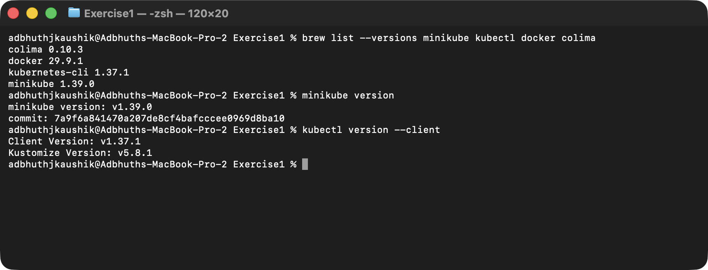
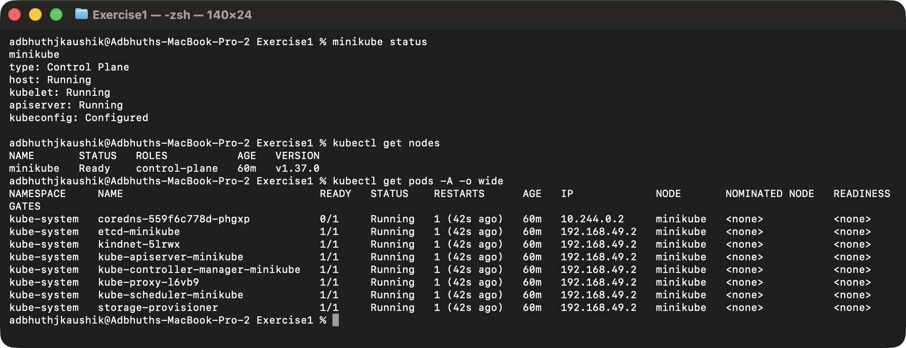
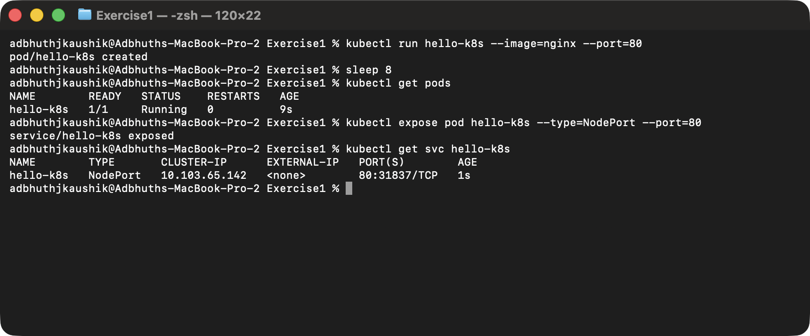
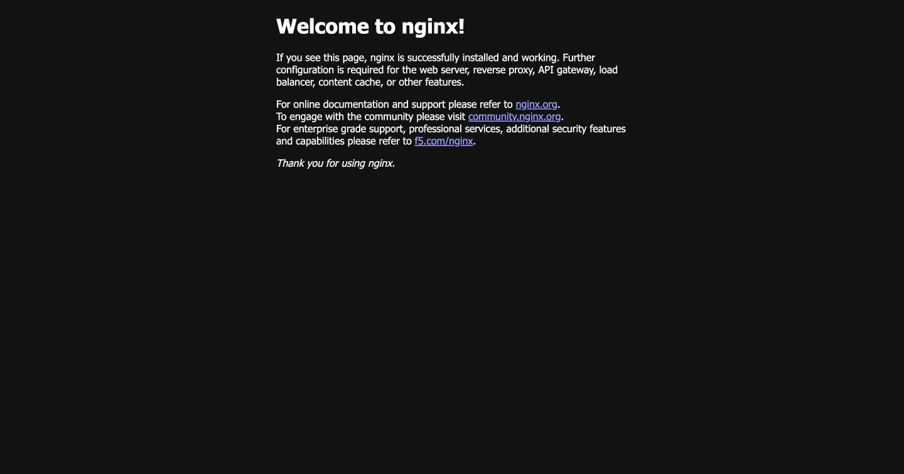

# Exercise 1: Kubernetes Getting Started

## Objective

Run a first containerised workload on Kubernetes locally — deploy an Nginx
pod on a Minikube cluster, expose it through a Service, and reach the Nginx
welcome page from the host browser.

## Environment

- Operating System: macOS 26 (Darwin arm64)
- Shell: zsh
- Container runtime: Docker (via Colima)
- Kubernetes distribution: Minikube `v1.39.0`
- Kubernetes CLI: `kubectl v1.37.1`

## Prerequisites

Installed via Homebrew:

```bash
brew install colima docker kubectl minikube
colima start
```

`colima` provides the Docker engine on macOS without needing Docker Desktop.
Everything else (`docker` CLI, `kubectl`, `minikube`) is a straight brew install.



## 1. Start the Minikube cluster

```bash
minikube start --driver=docker
```

Minikube pulls its base image, creates a Docker container that acts as the
single Kubernetes node, and provisions the control plane components
(`etcd`, `kube-apiserver`, `kube-controller-manager`, `kube-scheduler`,
`kube-proxy`, `coredns`). After the start finishes, the cluster shows a
single `control-plane` node in the `Ready` state.



## 2. Create the Nginx pod

```bash
kubectl run hello-k8s --image=nginx --port=80
```

`kubectl run` creates a Pod directly from the `nginx` image. The `--port=80`
flag records that the container listens on port 80 (it does not expose the
port by itself — that comes in step 4).

Verify:

```bash
kubectl get pods
```

The pod reaches `Running` once the image is pulled and the container is
started.

## 3. Expose the pod with a NodePort Service

```bash
kubectl expose pod hello-k8s --type=NodePort --port=80
```

This creates a Service of type `NodePort`, which asks Kubernetes to pick a
port in the 30000-32767 range on the node and forward it to port 80 of the
pod. The Service's cluster IP is also assigned.

```bash
kubectl get svc hello-k8s
```



## 4. Access the application

Because the Docker driver on macOS runs the node inside a container, the
NodePort isn't directly reachable from the host. Minikube provides a tunnel
command that forwards a local port to the Service:

```bash
minikube service hello-k8s --url
# http://127.0.0.1:64274
```

Opening the returned URL in a browser shows the default Nginx welcome page.



## Result

A single-command `nginx` deployment was running on a local Kubernetes
cluster and reachable from the host browser through a NodePort Service.
This covers the full "pod → service → external access" loop that every
later exercise builds on.

## Clean up

```bash
kubectl delete svc hello-k8s
kubectl delete pod hello-k8s
```
