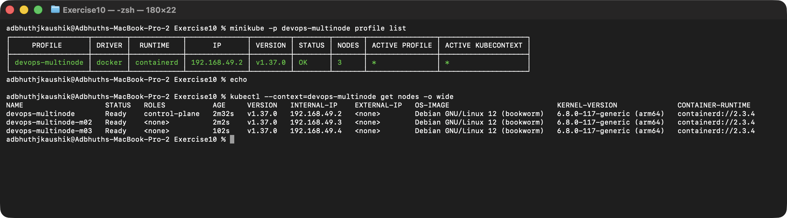
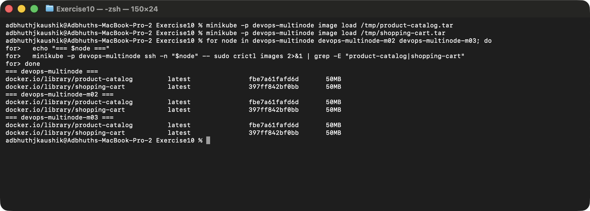
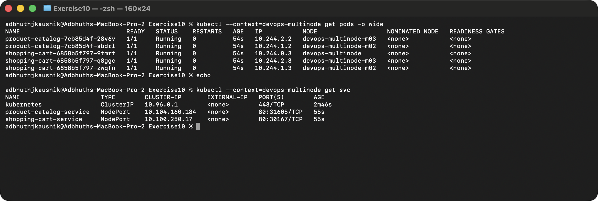
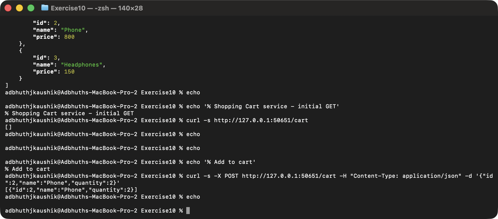

# Exercise 10: Multi-Node Minikube Cluster with Multiple Applications

## Objective

Run two independent Python Flask services — a `product-catalog` and a
`shopping-cart` — on a 3-node Minikube cluster, with `podAntiAffinity`
forcing their replicas onto different nodes so a node failure can't take
either service down.

## Storyboard

Mini e-commerce platform:
- **Product Catalog** (AppA) — lists products. 2 replicas.
- **Shopping Cart** (AppB) — manages a user's cart. 3 replicas.

Each replica of each service lands on a different Minikube node (via
`requiredDuringSchedulingIgnoredDuringExecution` pod anti-affinity).

## Environment

- Operating System: macOS 26 (Darwin arm64)
- Container Runtime: Docker (via Colima)
- Kubernetes distribution: Minikube `v1.39.0`, 3-node cluster, profile `devops-multinode`
- Kubernetes CLI: `kubectl v1.37.1`

## Step 0 — Clean up the old single-node cluster

```bash
minikube stop
minikube delete
```

## Step 1 — Start a 3-node Minikube cluster

```bash
minikube start --nodes 3 -p devops-multinode --driver=docker
```

Three nodes come up: one control-plane (`devops-multinode`) and two
workers (`devops-multinode-m02`, `devops-multinode-m03`).

```bash
kubectl --context=devops-multinode get nodes -o wide
```



## Step 2 — Flask apps + Dockerfiles

- [`product_catalog.py`](./product_catalog.py) — `/products` returns a
  hardcoded JSON array of 3 products.
- [`shopping_cart.py`](./shopping_cart.py) — `/cart` GET returns the
  cart, POST adds an item.
- [`Dockerfile.product`](./Dockerfile.product) /
  [`Dockerfile.shopping`](./Dockerfile.shopping) — minimal
  `python:3.9-slim` + `pip install flask` images.

Build both:

```bash
docker build -t product-catalog:latest -f Dockerfile.product .
docker build -t shopping-cart:latest   -f Dockerfile.shopping .
```

## Step 3 — Make the images available to every node

Minikube's `image load` ships an image into **every** node of the
multi-node cluster, so pods scheduled on any node can run them without
pulling from a remote registry.

```bash
docker save product-catalog:latest -o /tmp/product-catalog.tar
docker save shopping-cart:latest   -o /tmp/shopping-cart.tar
minikube -p devops-multinode image load /tmp/product-catalog.tar
minikube -p devops-multinode image load /tmp/shopping-cart.tar
```

Verify both images on all three nodes (Minikube v1.39 uses containerd —
`crictl images` is the right tool here, not `docker images`):

```bash
for node in devops-multinode devops-multinode-m02 devops-multinode-m03; do
  echo "=== $node ==="
  minikube -p devops-multinode ssh -n "$node" -- sudo crictl images | grep -E 'product-catalog|shopping-cart'
done
```



## Step 4 — Deployments and Services

Both deployments use `podAntiAffinity` with
`requiredDuringSchedulingIgnoredDuringExecution` on
`kubernetes.io/hostname`, so Kubernetes refuses to schedule two replicas
of the same app on the same node.

- [`product_catalog_deployment.yaml`](./product_catalog_deployment.yaml) — 2 replicas
- [`shopping_cart_deployment.yaml`](./shopping_cart_deployment.yaml) — 3 replicas
- [`product_catalog_service.yaml`](./product_catalog_service.yaml) — NodePort
- [`shopping_cart_service.yaml`](./shopping_cart_service.yaml) — NodePort

```bash
kubectl --context=devops-multinode apply -f product_catalog_deployment.yaml
kubectl --context=devops-multinode apply -f shopping_cart_deployment.yaml
kubectl --context=devops-multinode apply -f product_catalog_service.yaml
kubectl --context=devops-multinode apply -f shopping_cart_service.yaml
```

## Step 5 — Verify pod spread

```bash
kubectl --context=devops-multinode get pods -o wide
kubectl --context=devops-multinode get svc
```

Result: the 2 `product-catalog` pods are on `-m02` and `-m03`; the 3
`shopping-cart` pods are one per node. Anti-affinity worked.



## Step 6 — Access the services

Open two tunnels (the Docker driver on macOS requires an active
tunnel per NodePort service):

```bash
minikube -p devops-multinode service product-catalog-service --url
# http://127.0.0.1:50646
minikube -p devops-multinode service shopping-cart-service --url
# http://127.0.0.1:50651
```

Keep both terminals open.

## Step 7 — Hit the services with `curl`

```bash
curl http://127.0.0.1:50646/products
curl http://127.0.0.1:50651/cart
curl -X POST http://127.0.0.1:50651/cart \
  -H 'Content-Type: application/json' \
  -d '{"id":2,"name":"Phone","quantity":2}'
```

`/products` returns the 3-item catalog, `/cart` initially returns `[]`,
POSTing an item returns the updated cart.



## Clean up

```bash
minikube -p devops-multinode delete
```

## Key takeaways

- **Multi-node Minikube** is a single `minikube start --nodes N -p <profile>` away. The control plane runs on node 1; workers are `-m02`, `-m03`, …
- **Image distribution** — on a multi-node cluster, `eval $(minikube docker-env)` only touches one node's runtime. `minikube image load <tar>` is the right tool: it loads the image into **every** node, which is what `imagePullPolicy: Never` needs.
- **Pod spread** is driven by anti-affinity, not luck. `requiredDuringSchedulingIgnoredDuringExecution` on `kubernetes.io/hostname` means "never two of me on the same host". For soft spreading, use `preferredDuringSchedulingIgnoredDuringExecution` with weights.
- **NodePort + Docker driver on macOS** needs `minikube service ... --url` to keep a local tunnel open — the node's advertised IP isn't directly routable from the host.
