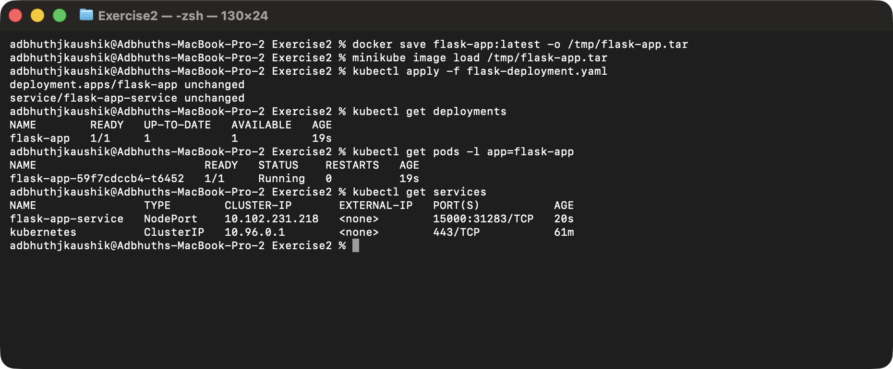

# Exercise 2: Deploy a Flask App on Minikube using kubectl and YAML

## Objective

Package a small Python Flask application into a container image, run that
image on a local Minikube cluster through a `Deployment`, and expose it to
the host via a `NodePort` Service so the response can be verified from a
browser / `curl`.

## Environment

- Operating System: macOS 26 (Darwin arm64)
- Shell: zsh
- Container runtime: Docker (via Colima)
- Kubernetes distribution: Minikube `v1.39.0`
- Kubernetes CLI: `kubectl v1.37.1`

## Prerequisites

Same as Exercise 1 — Colima, Docker CLI, `kubectl` and Minikube installed
through Homebrew. A running Minikube cluster from `minikube start`.

## 1. Start Minikube

```bash
minikube start --driver=docker
```

(Already running from Exercise 1 in my case.)

## 2. The Flask application

`app.py` — a single-route Flask app bound to `0.0.0.0:15000` so it is
reachable from outside the container.

```python
from flask import Flask
app = Flask(__name__)

@app.route('/')
def home():
    return "Hello from Flask on Kubernetes!"

if __name__ == '__main__':
    app.run(host='0.0.0.0', port=15000)
```

## 3. The Dockerfile

```dockerfile
FROM python:3.8-slim
WORKDIR /app
COPY . /app
RUN pip install flask
CMD ["python", "app.py"]
```

## 4. Build the image and make it available to the cluster

The canonical "point docker at Minikube's daemon" trick:

```bash
eval $(minikube docker-env)
docker build -t flask-app:latest .
```

On this machine Minikube is using the containerd runtime, so I instead
built the image with Colima's Docker and loaded the resulting image into
the Minikube node:

```bash
docker build -t flask-app:latest .
docker save flask-app:latest -o /tmp/flask-app.tar
minikube image load /tmp/flask-app.tar
```

Either approach produces the same thing: a `flask-app:latest` image that
exists inside the cluster, so Kubernetes can run it without pulling from a
remote registry.

## 5. Deployment + Service manifest

`flask-deployment.yaml` defines both the `Deployment` (one replica of the
Flask container) and the `NodePort` Service in front of it. `imagePullPolicy:
Never` tells Kubernetes to use the local image instead of trying to pull it.

```yaml
apiVersion: apps/v1
kind: Deployment
metadata:
  name: flask-app
spec:
  replicas: 1
  selector:
    matchLabels:
      app: flask-app
  template:
    metadata:
      labels:
        app: flask-app
    spec:
      containers:
        - name: flask-app
          image: flask-app:latest
          imagePullPolicy: Never
          ports:
            - containerPort: 15000
---
apiVersion: v1
kind: Service
metadata:
  name: flask-app-service
spec:
  selector:
    app: flask-app
  ports:
    - port: 15000
      targetPort: 15000
  type: NodePort
```

### Apply the manifest

```bash
kubectl apply -f flask-deployment.yaml
```

### Verify

```bash
kubectl get deployments
kubectl get pods -l app=flask-app
kubectl get services
```



## 6. Access the application

Because the Docker driver on macOS runs the node inside a container, the
NodePort can't be reached directly — Minikube provides a short-lived
tunnel URL:

```bash
minikube service flask-app-service --url
# http://127.0.0.1:65010
```

```bash
curl http://127.0.0.1:65010
# Hello from Flask on Kubernetes!
```

Opening the same URL in the browser:


## Result

Built the Flask application as a Docker image, loaded it into the Minikube
cluster, deployed it with a `Deployment`, and exposed it to the host via a
`NodePort` Service. The app responded with `Hello from Flask on Kubernetes!`
through both `curl` and the browser via the Minikube service tunnel.

## Clean up

```bash
kubectl delete -f flask-deployment.yaml
```
