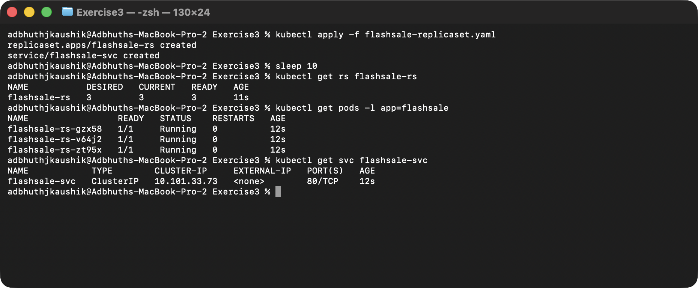
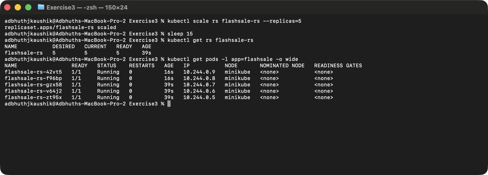
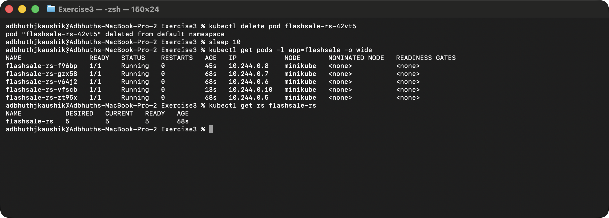

# Exercise 3: Scaling a Flask App on a Single Node Using ReplicaSets

## Objective

Use a Kubernetes `ReplicaSet` to run multiple copies of a small Flask
"flash sale" application, scale the replica count up, and watch
Kubernetes automatically replace a pod that gets deleted — showing how
ReplicaSets maintain a desired state for resiliency and horizontal
scaling.

## Why this matters

During a flash sale (think Big Billion Days or Prime Day) a single Flask
pod would collapse under traffic spikes. A `ReplicaSet` lets the same
app run as several identical pods, with Kubernetes handling pod
replacement if one dies. Once traffic drops, the replica count can be
dialled back down.

## Environment

- Operating System: macOS 26 (Darwin arm64)
- Shell: zsh
- Container runtime: Docker (via Colima)
- Kubernetes distribution: Minikube `v1.39.0`, single node
- Kubernetes CLI: `kubectl v1.37.1`

## 1. The flash-sale Flask app

`app.py` exposes three routes:

- `/` — welcome message that also prints which pod served the request.
- `/buy` — simulates a checkout; picks a random product and shows the
  serving pod (so you can watch requests spread across pods).
- `/health` — used by the readiness and liveness probes.

```python
from flask import Flask, request
import socket, time, random

app = Flask(__name__)

@app.get("/")
def homepage():
    return {"message": "Welcome to Big Sale!",
            "pod": socket.gethostname(),
            "ts": time.time()}

@app.get("/buy")
def buy():
    item = random.choice(["Smartphone", "Shoes", "Headphones", "Laptop"])
    user = request.args.get("user", f"user{random.randint(1,1000)}")
    return {"status": "success", "item": item, "user": user,
            "served_by_pod": socket.gethostname(),
            "time": time.strftime("%H:%M:%S")}

@app.get("/health")
def health():
    return {"status": "healthy", "pod": socket.gethostname()}
```

## 2. The Dockerfile

```dockerfile
FROM python:3.11-slim
WORKDIR /app
COPY app.py .
RUN pip install --no-cache-dir flask gunicorn
CMD ["gunicorn", "-b", "0.0.0.0:5000", "app:app", "--workers", "1", "--threads", "2"]
```

Serving with `gunicorn` instead of the Flask dev server, since this is
meant to simulate production-ish load.

## 3. Build the image and make it available to the cluster

Same approach as Exercise 2: build with Colima's Docker, then push the
image into the Minikube node.

```bash
docker build -t flashsale:1.0 .
docker save flashsale:1.0 -o /tmp/flashsale.tar
minikube image load /tmp/flashsale.tar
```

## 4. The ReplicaSet + Service manifest

`flashsale-replicaset.yaml` requests 3 replicas, defines
readiness/liveness probes against `/health`, pins CPU/memory requests
and limits, and puts a `ClusterIP` Service in front of the pods.

```yaml
apiVersion: apps/v1
kind: ReplicaSet
metadata:
  name: flashsale-rs
  labels:
    app: flashsale
spec:
  replicas: 3
  selector:
    matchLabels:
      app: flashsale
  template:
    metadata:
      labels:
        app: flashsale
    spec:
      containers:
        - name: flashsale-container
          image: flashsale:1.0
          imagePullPolicy: Never
          ports:
            - containerPort: 5000
          readinessProbe:
            httpGet:
              path: /health
              port: 5000
            initialDelaySeconds: 2
            periodSeconds: 5
          livenessProbe:
            httpGet:
              path: /health
              port: 5000
            initialDelaySeconds: 10
            periodSeconds: 10
          resources:
            requests:
              cpu: "100m"
              memory: "128Mi"
            limits:
              cpu: "500m"
              memory: "256Mi"
---
apiVersion: v1
kind: Service
metadata:
  name: flashsale-svc
spec:
  selector:
    app: flashsale
  ports:
    - name: http
      port: 80
      targetPort: 5000
  type: ClusterIP
```

## 5. Apply and verify (3 pods)

```bash
kubectl apply -f flashsale-replicaset.yaml
kubectl get rs flashsale-rs
kubectl get pods -l app=flashsale
kubectl get svc flashsale-svc
```

Once the readiness probe passes, the `ReplicaSet` shows
`3 DESIRED / 3 CURRENT / 3 READY`.



## 6. Scale to 5 replicas

```bash
kubectl scale rs flashsale-rs --replicas=5
kubectl get rs flashsale-rs
kubectl get pods -l app=flashsale -o wide
```

Kubernetes creates 2 additional pods to meet the new desired count,
scheduling them on the single `minikube` node.



## 7. Delete a pod and watch Kubernetes self-heal

```bash
kubectl delete pod flashsale-rs-86gf8
kubectl get pods -l app=flashsale -o wide
```

The ReplicaSet controller immediately spins up a replacement pod
(`flashsale-rs-lwsps`, age 7s in the screenshot) so the desired count of
5 is maintained — the user wouldn't notice the drop.



## Observations

- **Pod distribution** — each pod is an identical worker; "scale" just
  means "run more clones".
- **Resiliency** — deleting a pod didn't reduce the replica count: the
  ReplicaSet controller replaced it immediately.
- **Single node** — with the default `--nodes=1`, all 5 pods are
  scheduled on the same minikube node (visible in the `-o wide` output).
- **Deployment vs ReplicaSet** — in real usage you'd use a `Deployment`
  (which creates ReplicaSets under the hood) so that rolling updates and
  rollbacks are available; `ReplicaSet` is the right primitive to learn
  on because it keeps the scaling / self-healing semantics in focus.

## Clean up

```bash
kubectl delete -f flashsale-replicaset.yaml
```
