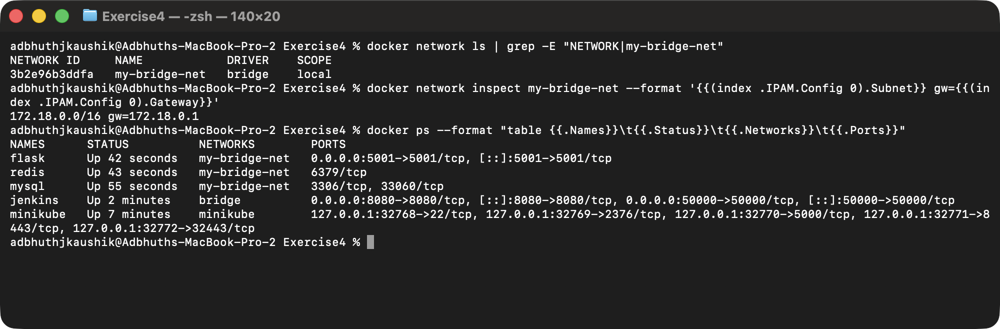
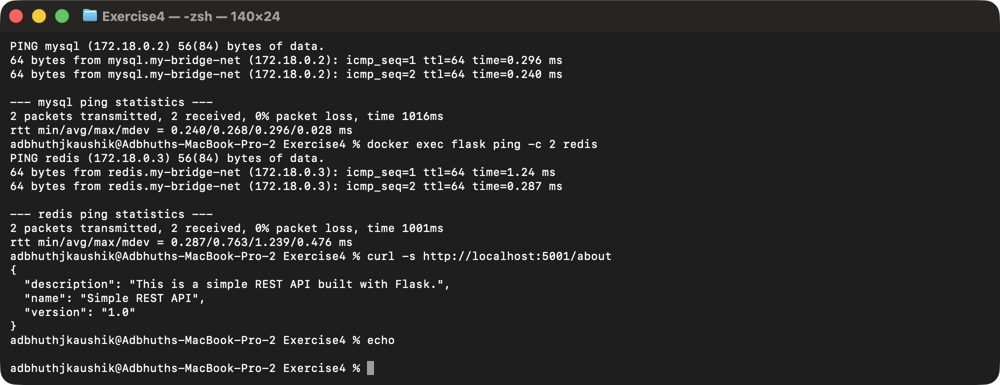

# Exercise 4: Docker Networking with Multiple Containers

## Objective

Set up a multi-container app on a user-defined bridge network — a Flask
API, a MySQL database, and a Redis cache — and prove the containers can
talk to each other by name while the API stays reachable from the host.

## Environment

- Operating System: macOS 26 (Darwin arm64)
- Shell: zsh
- Container Runtime: Docker (via Colima)

## Task 1 — Create a bridge network

```bash
docker network create --driver bridge my-bridge-net
```

## Task 2 — Verify

```bash
docker network ls
```

`my-bridge-net` is listed alongside Docker's defaults with `bridge` driver,
`local` scope.

## Task 3 — Inspect

```bash
docker network inspect my-bridge-net
```

Docker allocated a dedicated subnet for the network — in my case
`172.18.0.0/16`, gateway `172.18.0.1`.

## Task 4 — Build and launch

Flask app ([`app.py`](./app.py)) exposes a single `/about` route returning
JSON. Dependencies ([`requirements.txt`](./requirements.txt)) pin
`Flask==2.0.1` **and** `Werkzeug==2.0.3` — without pinning Werkzeug the
container crashed at import because the latest Werkzeug dropped
`werkzeug.urls.url_quote` that this old Flask relies on. Image built from
the included [`Dockerfile`](./Dockerfile).

```bash
docker build -t flask-api .

docker run -d --name mysql --net=my-bridge-net -e MYSQL_ROOT_PASSWORD=rootpass mysql:latest
docker run -d --name redis --net=my-bridge-net redis:latest
docker run -d --name flask --net=my-bridge-net -p 5001:5001 flask-api
```

`mysql:latest` refuses to start without a root password set (via
`MYSQL_ROOT_PASSWORD` or one of its related env vars), so I added that
flag — the original command would have left MySQL in `Exited (1)`.



## Task 5 — Test connectivity

Docker's embedded DNS resolves container names to their bridge-network IPs
for containers on the same user-defined network, so the Flask container
can reach the other two by name:

```bash
docker exec flask ping -c 2 mysql
docker exec flask ping -c 2 redis
curl http://localhost:5001/about
```

`python:3.9-slim` doesn't ship `ping`, so I installed `iputils-ping`
inside the Flask container first:

```bash
docker exec flask apt-get update -qq
docker exec flask apt-get install -y iputils-ping
```



## Task 6 — Clean up

```bash
docker stop mysql redis flask
docker rm mysql redis flask
docker network rm my-bridge-net
```

## Key concepts

- `--net` connects a container to a specific Docker network instead of the
  default `bridge` network.
- Containers on the **same user-defined bridge network** can reach each
  other **by container name** — Docker runs an embedded DNS resolver that
  maps names to bridge-network IPs. On the *default* `bridge` this only
  works via `--link` (deprecated), which is why a custom network is
  idiomatic.
- A **bridge network** gives containers a private virtual network, reached
  from the host only through published ports (`-p`); a **host network**
  shares the host's network namespace directly — no isolation, no port
  mapping needed.
- `-p <host-port>:<container-port>` publishes a container's port to the
  host so clients outside the Docker network can reach it.
