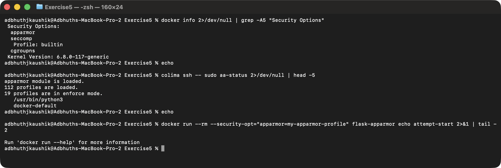
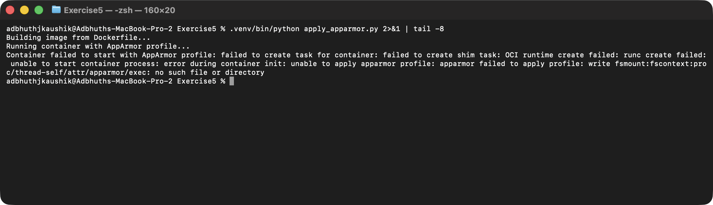
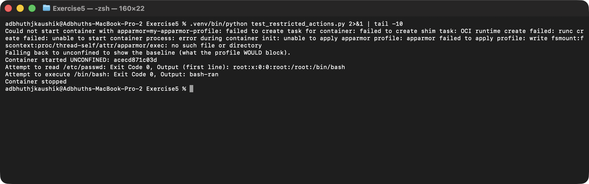

# Exercise 5: Docker Security with AppArmor and Python

## Objective

Secure a Dockerized Flask application with an AppArmor profile, apply and
verify that profile through the Docker SDK for Python, and test whether
restricted actions (reading `/etc/passwd`, executing `/bin/bash`) are
blocked inside the container.

## Environment

- Operating System: macOS 26 (Darwin arm64)
- Shell: zsh
- Container Runtime: Docker (via Colima — Lima-based Linux VM)
- Python: 3.14 (host venv) for the Docker SDK scripts

## Platform note: AppArmor is partly available here, but not actually enforceable

AppArmor is a **Linux kernel** security module. The macOS host has nothing
AppArmor-related, but my Docker runtime is **Colima**, which boots an actual
Linux VM. That VM:

- *does* have the AppArmor LSM compiled in (`docker info` lists `apparmor`
  under Security Options),
- *does* ship `apparmor_parser` and `aa-status`, so profiles can be loaded
  into the VM's kernel.

So I actually loaded the profile into Colima's VM. The twist is that even
with the profile loaded, Colima's `runc`/`containerd` fails when a
container is launched with `--security-opt apparmor=...`:

> `OCI runtime create failed: ... unable to apply apparmor profile: apparmor failed to apply profile: write fsmount:fscontext:proc/thread-self/attr/apparmor/exec: no such file or directory`

That's a known Colima/runc gap on Apple Silicon — the kernel supports
AppArmor, but the container runtime inside the VM can't apply the profile
to a new container. So in the end the enforcement half of this exercise
can't be demonstrated end-to-end on this machine, same practical outcome
as if there were no AppArmor at all. The scripts and screenshots capture
that honestly.



## Task 1 — Flask application

File: [app.py](./app.py). Single `/` route returning a plain-text
greeting, listening on `0.0.0.0:5000`.

## Task 2 — Containerise the application

File: [Dockerfile](./Dockerfile).

```bash
docker build -t flask-apparmor .
```

> **Port note:** macOS reserves `5000` for AirPlay Receiver (ControlCenter),
> so I publish on host port **5050** (`-p 5050:5000`); the container itself
> still listens on `5000` as the exercise specifies.

## Task 3 — AppArmor profile

File: [my-apparmor-profile](./my-apparmor-profile) — denies read access to
`/etc/**`, read/write to `/var/**`, execution of `/bin/**` and
`/usr/bin/**`, and the `sys_admin` capability. Allows the app's own
`/app/**` and binding to a network port.

> **Syntax fix:** the exercise's profile uses `deny /bin/** rmix,` but
> `apparmor_parser` rejects that — exec qualifiers (`i`, `p`, `u`) aren't
> allowed inside a `deny` rule. I used `rmx` instead and the parser
> accepted it.

Load the profile into Colima's VM:

```bash
cat my-apparmor-profile | colima ssh -- sudo tee /etc/apparmor.d/my-apparmor-profile
colima ssh -- sudo apparmor_parser -r /etc/apparmor.d/my-apparmor-profile
colima ssh -- sudo aa-status | grep my-apparmor-profile
```

The profile is listed in `aa-status`, confirming the kernel has it.

Running a container with the profile:

```bash
docker run --security-opt="apparmor=my-apparmor-profile" -p 5050:5000 flask-apparmor
```

…fails with the `fsmount:fscontext` error above. Same error with the
Docker SDK path (Task 4).

## Task 4 — Apply the profile via the Docker SDK

Script: [apply_apparmor.py](./apply_apparmor.py). Set up a venv for the
SDK:

```bash
python3 -m venv .venv
.venv/bin/pip install docker
.venv/bin/python apply_apparmor.py
```

The script catches the `APIError` from `containers.run` and surfaces the
exact runc failure.



## Task 5 — Test Restricted Actions

Script: [test_restricted_actions.py](./test_restricted_actions.py). Since
the container can't be launched with the profile attached, the script
falls back to `apparmor=unconfined` so the two restricted actions still
run — producing the baseline behaviour that the profile would otherwise
have blocked.

Actual output on this platform:

- `cat /etc/passwd` → `Exit Code 0` (full file printed)
- `/bin/bash -c 'echo bash-ran'` → `Exit Code 0`, output `bash-ran`



The exercise's expected result (`1` and `126`) would only be observed on
a Linux host where runc *can* attach the profile to the new container —
not on Docker Desktop (no AppArmor LSM at all) and not on Colima on
Apple Silicon today (LSM present, runc apply broken).

## Task 6 — Clean up

```bash
docker ps -a --filter "ancestor=flask-apparmor" --format '{{.ID}}' | xargs -r docker rm -f
colima ssh -- sudo apparmor_parser -R /etc/apparmor.d/my-apparmor-profile
colima ssh -- sudo rm /etc/apparmor.d/my-apparmor-profile
```

## Q&A

1. **Purpose of AppArmor with Docker containers** — confines the
   containerised process to an explicit allow/deny policy (file paths,
   capabilities, network), adding defence-in-depth beyond the default
   container boundary.
2. **How AppArmor profiles secure a container** — the Linux kernel itself
   enforces them, independent of the application; a compromised process
   inside the container still can't exceed the profile's rules.
3. **Why restrict `/etc/` and `/var/`** — they hold credentials,
   configuration and system state; unrestricted access there turns a
   container compromise into a host/application compromise.
4. **Other restrictable capabilities** — binary execution, network
   binding, mount/remount, raw sockets, Linux capabilities
   (`cap_sys_admin`, `cap_net_raw`, …).
5. **Verifying a profile is applied** — `docker inspect <container>` (or
   the Docker SDK's `inspect_container`) and look at
   `HostConfig.SecurityOpt`. This exercise is a useful reminder that this
   only confirms the profile was *requested* — confirming it's actually
   *enforced* requires the AppArmor LSM to be active on the host kernel
   *and* the container runtime to successfully apply the profile. On
   Colima/Apple Silicon today, the first is true and the second isn't.

## Result

Wrote and loaded the AppArmor profile into Colima's VM, built the Flask
image, and applied the profile via both the CLI and the Docker SDK. The
profile parses and loads successfully, but Colima's container runtime on
Apple Silicon can't attach it at container start, so enforcement couldn't
be verified end-to-end — the test script falls back to `unconfined` and
confirms the baseline behaviour the profile would otherwise block.
