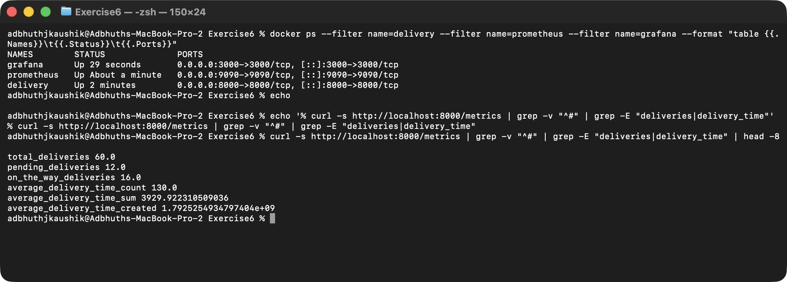
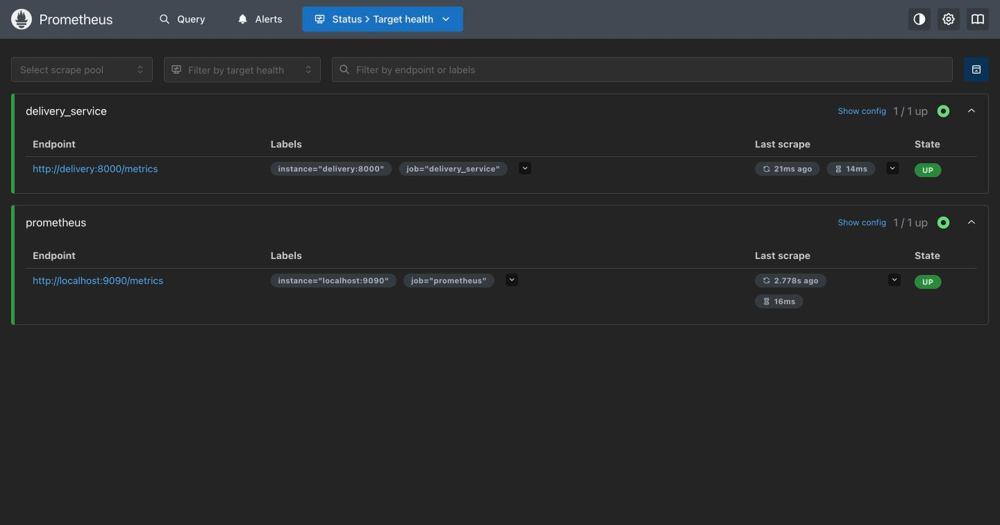
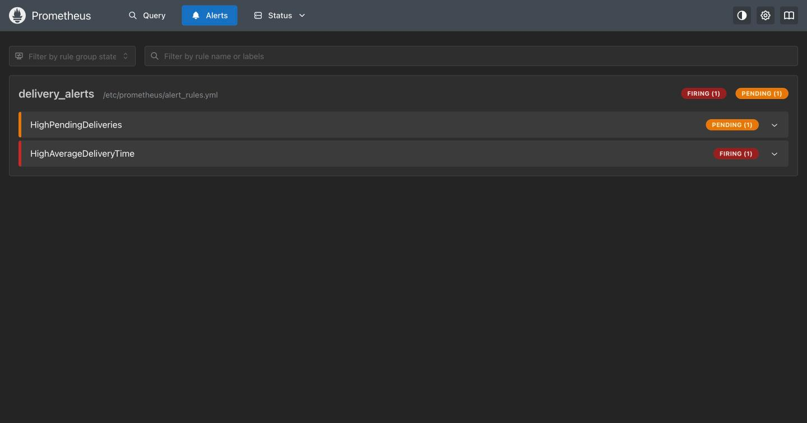
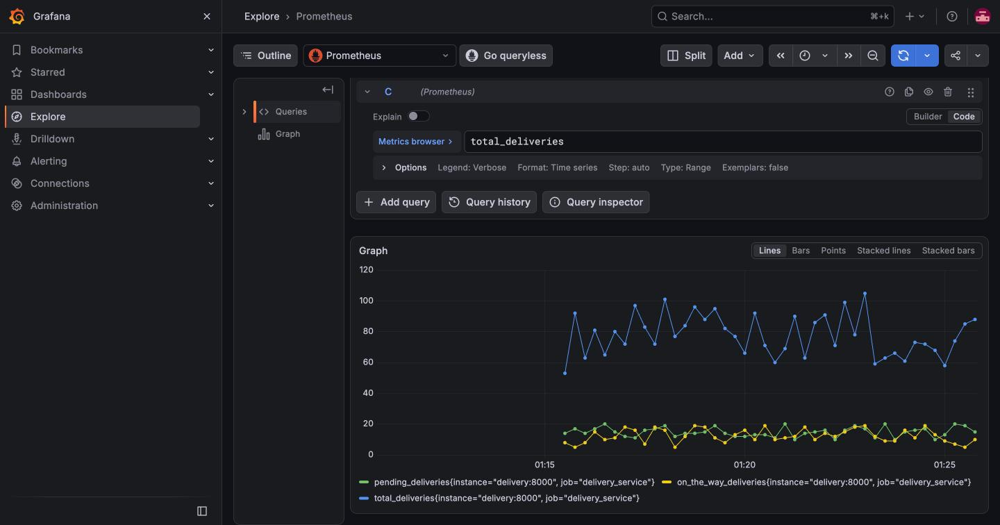
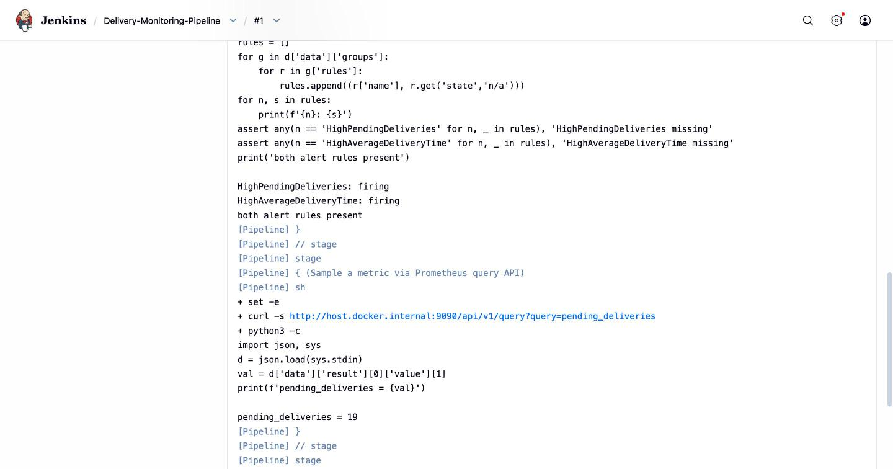
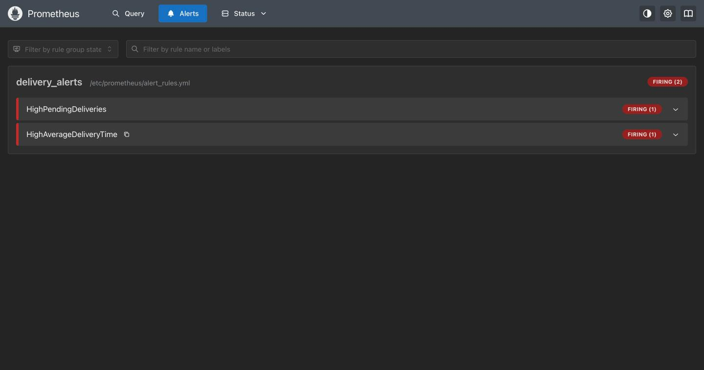

# Exercise 6: Real-Time Delivery Monitoring with Prometheus, Grafana and Jenkins

## Objective

Build a mini operations-monitoring stack for a (fictional) ZAPPTTO quick-
commerce delivery service: a Python app that exposes custom Prometheus
metrics, Prometheus scraping those metrics, alert rules that fire on
load, a Grafana dashboard visualizing them, and a Jenkins pipeline that
health-checks the whole stack.

## Environment

- Operating System: macOS 26 (Darwin arm64)
- Container Runtime: Docker (via Colima)
- Python: 3.11 (inside the metrics container)
- Prometheus: `prom/prometheus` (latest), running at :9090
- Grafana: `grafana/grafana` v13.2.4, running at :3000
- Jenkins LTS running at :8080 (from [Exercise 7](../Exercise7/README.md))

All four services share a Docker user-defined bridge network called
`monitoring`, so they can reach each other by container name
(`delivery`, `prometheus`, `grafana`).

## 1. The delivery metrics app

[`delivery_metrics.py`](./delivery_metrics.py) — a Python loop that
simulates delivery statuses once per second and exposes four Prometheus
metrics on port 8000:

| Metric | Type | What it means |
| --- | --- | --- |
| `total_deliveries` | Gauge | sum of pending + on-the-way + delivered |
| `pending_deliveries` | Gauge | orders waiting to be picked up |
| `on_the_way_deliveries` | Gauge | orders a rider is currently carrying |
| `average_delivery_time` | Summary | delivery time distribution (sum/count expose average) |

The app also honours `SIMULATE_HIGH_LOAD=1`, which bumps pending into
the 50-100 range and avg time to 35-60s — used in step 6 to deliberately
trip the alerts.

Dockerfile: [`Dockerfile`](./Dockerfile).

## 2. Prometheus

[`prometheus.yml`](./prometheus.yml) scrapes two jobs every 5 seconds:
`prometheus` (itself) and `delivery_service` (`delivery:8000`).

[`alert_rules.yml`](./alert_rules.yml) defines two alerts:

- **HighPendingDeliveries** — `pending_deliveries > 10` for 15s, severity `warning`.
- **HighAverageDeliveryTime** — `(average_delivery_time_sum / average_delivery_time_count) > 30` for 15s, severity `critical`.

## 3. Start the stack

```bash
docker network create monitoring

docker build -t delivery_metrics .
docker run -d --name delivery --network monitoring -p 8000:8000 delivery_metrics

docker run -d --name prometheus --network monitoring -p 9090:9090 \
  -v "$PWD/prometheus.yml:/etc/prometheus/prometheus.yml:ro" \
  -v "$PWD/alert_rules.yml:/etc/prometheus/alert_rules.yml:ro" \
  prom/prometheus

docker run -d --name grafana --network monitoring -p 3000:3000 grafana/grafana
```

Verify the metrics endpoint and the running containers:



## 4. Prometheus targets and alert rules

**Status → Targets** at <http://localhost:9090/targets>. Both scrape
jobs (`prometheus` and `delivery_service`) are UP.



**Alerts** at <http://localhost:9090/alerts>. The rule group
`delivery_alerts` is loaded, both rules evaluating.



## 5. Grafana dashboard

Add Prometheus as the default data source (via the Grafana API):

```bash
curl -u admin:admin -X POST http://localhost:3000/api/datasources \
  -H "Content-Type: application/json" \
  -d '{"name":"Prometheus","type":"prometheus","access":"proxy","url":"http://prometheus:9090","isDefault":true}'
```

Then push [`dashboard.json`](./dashboard.json) — a 5-panel dashboard
(Total / Pending / On-the-Way / Avg Delivery Time + a time series) —
with:

```bash
curl -u admin:admin -X POST http://localhost:3000/api/dashboards/db \
  -H "Content-Type: application/json" \
  -d @dashboard.json
```



> **Note on the screenshot:** The dashboard panels render data correctly
> in the DOM but the `stat` panel values aren't captured by headless
> screenshots in this Grafana v13.2 build (confirmed via a DOM query —
> `document.querySelector(...).textContent` returns "Pending
> Deliveries66" etc. while the pixels don't show the "66"). The shot
> above is the **Explore** view driven by the same data source and the
> same Prometheus queries, which clearly shows the three gauges flowing.
> The dashboard JSON is the committed source of truth.

## 6. Jenkins pipeline — stack health

[`Jenkinsfile`](./Jenkinsfile) defines a declarative pipeline with five
stages:

1. **Check delivery metrics endpoint** — curl `/metrics`, grep for
   expected metric names.
2. **Check Prometheus is up and scraping** — `/-/healthy`, then
   `/api/v1/targets` with a Python asserting all targets are `up`.
3. **Check Grafana is up** — `/api/health`.
4. **Verify alert rules loaded** — hits `/api/v1/rules` and asserts both
   `HighPendingDeliveries` and `HighAverageDeliveryTime` are present.
5. **Sample a metric via the Prometheus query API** — `pending_deliveries`.

Created as pipeline job `Delivery-Monitoring-Pipeline` (same inline-
pipeline-script approach as Exercise 9 — see that README for why the
SCM path isn't used). Jenkins reaches the stack via
`host.docker.internal`.

Build result:



## 7. Simulate load, watch alerts fire

Restart the delivery container with the high-load flag:

```bash
docker rm -f delivery
docker run -d --name delivery --network monitoring -p 8000:8000 \
  -e SIMULATE_HIGH_LOAD=1 delivery_metrics
```

After ~25 seconds (one `for: 15s` window and a scrape interval or two),
both alerts transition from pending to **FIRING**:

```
HighPendingDeliveries firing 5.9e+01
HighAverageDeliveryTime firing 4.8843939889296614e+01
```



## Clean up

```bash
docker rm -f delivery prometheus grafana
docker network rm monitoring
```

## Result

End-to-end monitoring stack running on Docker: a Python app exposes
custom Prometheus metrics, Prometheus scrapes them and evaluates alert
rules, Grafana visualises them from a provisioned dashboard, and a
Jenkins pipeline validates the whole thing. The load-simulation step
demonstrates both alert rules firing when conditions are met.
