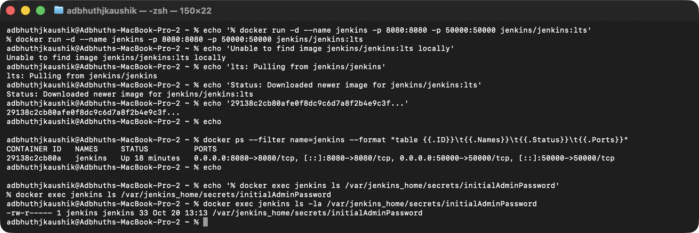
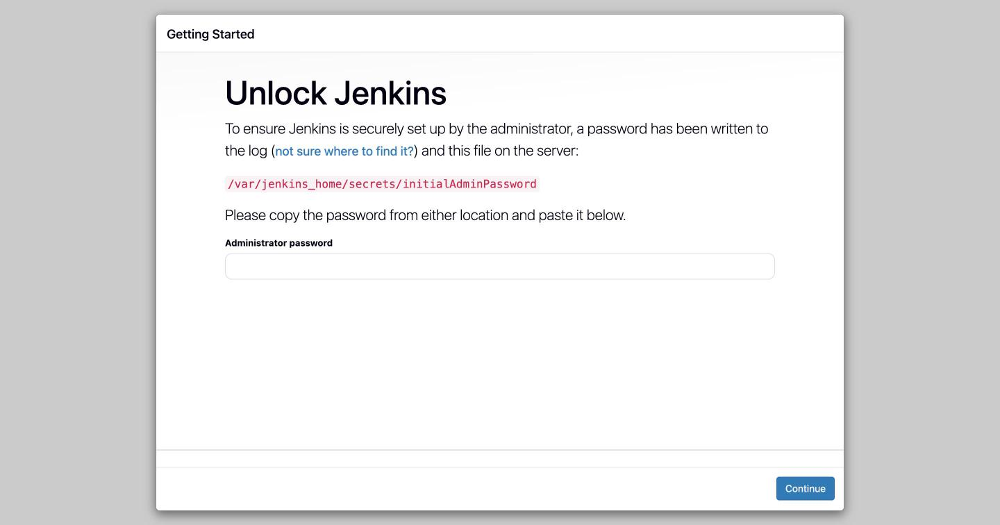
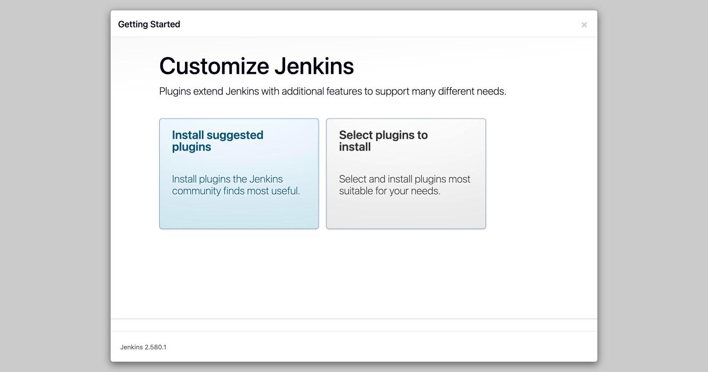
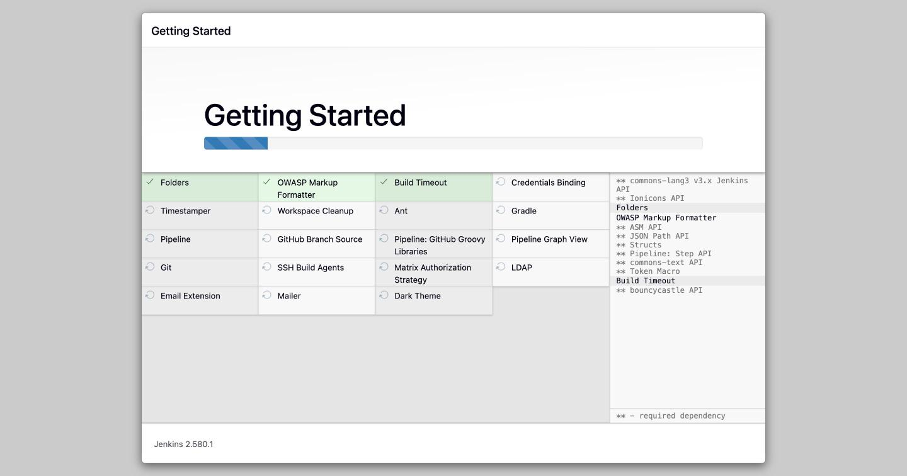
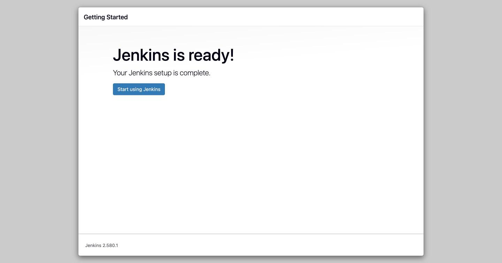
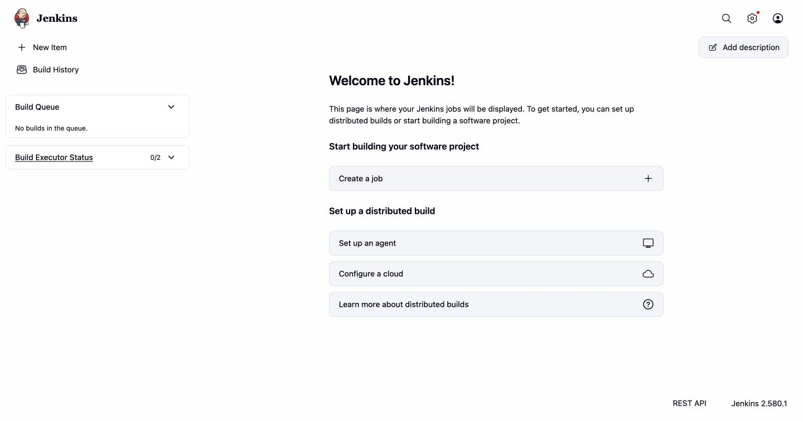

# Exercise 7: Introduction to Continuous Integration and Jenkins

## What is Continuous Integration (CI)?

CI is the practice of merging code changes into a shared repository
frequently — many times a day — and automatically building and testing
every change. The goal is to catch integration problems while they are
still small and cheap to fix, instead of letting them pile up at the end
of a sprint.

### Key features

1. **Frequent integration** — developers commit to a shared branch many
   times a day.
2. **Automated builds** — every commit triggers an automated build.
3. **Automated tests** — unit and integration tests run as part of every
   build.
4. **Immediate feedback** — the pipeline tells developers almost
   immediately whether their change broke something.

### Benefits

- Early bug detection, when fixes are cheap.
- Smoother collaboration — no "big bang" merges at release time.
- Faster release cadence, because builds and tests are automated.
- Higher baseline code quality — regressions get caught by the pipeline
  before they ship.

### How it works

1. A developer pushes code to version control.
2. The CI server (Jenkins, GitLab CI, GitHub Actions, …) picks the change
   up and triggers a build.
3. The code is compiled / packaged, dependencies installed.
4. Automated tests run.
5. The result is reported back to the developer (and often blocks a merge
   if red).

### Popular CI tools, at a glance

- **GitLab CI/CD** — built into GitLab, YAML pipelines, strong fit for
  teams that already live in GitLab.
- **CircleCI** — cloud-based, strong Docker integration, popular for
  containerised workflows.
- **Travis CI** — classic open-source CI, YAML-driven, deep GitHub
  integration (especially for public projects).
- **Bamboo** — Atlassian's CI, pairs well with JIRA and Bitbucket.
- **TeamCity** — JetBrains CI/CD server, enterprise-friendly reporting.
- **Azure DevOps Pipelines** — Microsoft's CI/CD, YAML or classic editor,
  multi-platform.
- **GitHub Actions** — in-repo YAML workflows, enormous marketplace of
  reusable actions.
- **Spinnaker** — multi-cloud continuous delivery, Netflix-origin,
  strong on canary / blue-green deploys.
- **Buildkite** — hybrid: hosted control plane, self-hosted agents.
- **Drone** — container-native CI, each step runs in a container.

---

## What is Jenkins?

Jenkins is an open-source automation server used to build, test and
deploy software. It is the long-running flagship of the self-hosted CI
world and is extremely plugin-driven.

**Why Jenkins:** automation of repetitive tasks, enables CI/CD, has an
enormous plugin ecosystem, and scales horizontally with agent nodes.

### Core concepts

- **Job / project** — a unit of work Jenkins runs (freestyle, pipeline,
  multibranch, folder, …).
- **Build** — one execution of a job.
- **Pipeline** — a sequence of stages (`checkout → build → test → deploy`)
  defined in a `Jenkinsfile`.
- **Plugins** — everything from source control integrations to
  deployment targets is a plugin.
- **Nodes** — the controller and its agents.

---

## Install Jenkins using Docker

```bash
docker run -d --name jenkins \
  -p 8080:8080 -p 50000:50000 \
  -v jenkins_home:/var/jenkins_home \
  jenkins/jenkins:lts
```

Port 8080 is Jenkins's web UI; 50000 is the inbound-agent port. I'm using
Docker on Colima.

### Find the initial admin password

Jenkins writes a one-time setup password to
`/var/jenkins_home/secrets/initialAdminPassword` on first boot (and to
its logs):

```bash
docker exec jenkins cat /var/jenkins_home/secrets/initialAdminPassword
```



## Open Jenkins at <http://localhost:8080/>

### 1. Unlock Jenkins

Paste the initial admin password into the "Administrator password"
field, then **Continue**.



### 2. Customize Jenkins

Pick **Install suggested plugins** (adds Git, Pipeline, Credentials,
Timestamper, Workspace Cleanup, Dark Theme, etc. — enough to do real
work, with no manual plugin picking).



### 3. Install plugins

Jenkins installs the suggested set — this is the slowest step of the
whole setup on a fresh image because every plugin and its transitive
dependencies gets pulled over the network.



### 4. Create first admin user → Instance configuration → Done

After the plugin install, Jenkins asks for a first admin user and the
canonical URL (I left it at `http://localhost:8080/`). Then:



### 5. Dashboard

Clicking **Start using Jenkins** lands on the empty dashboard — ready for
the first job (that's Exercise 8).



## Result

Jenkins LTS is up on `http://localhost:8080/`, the suggested plugin set
is installed, and the first admin user is created. Ready for Exercises 8
and 9.
