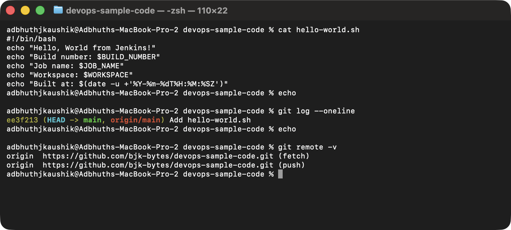
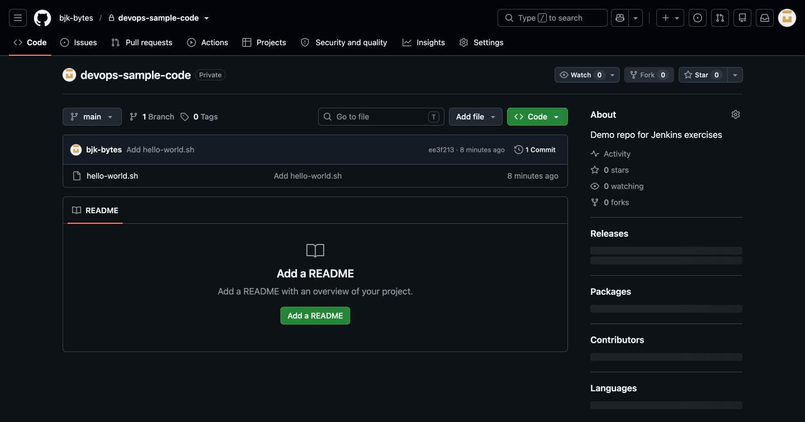
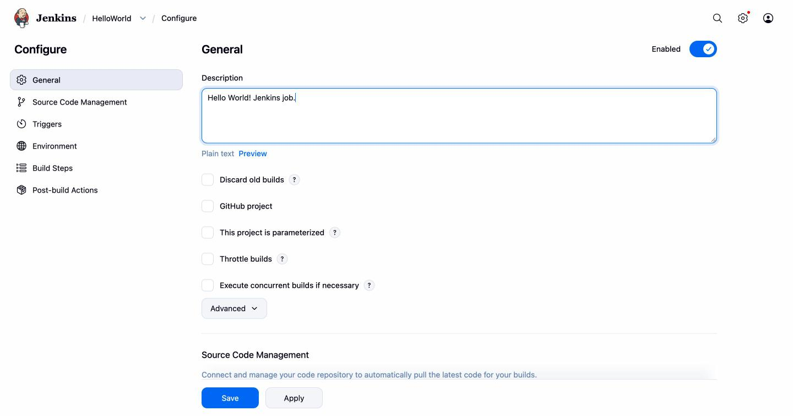
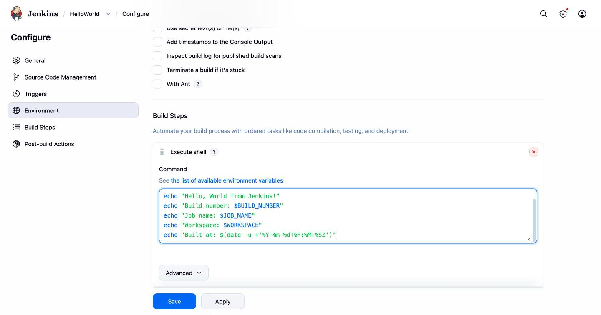
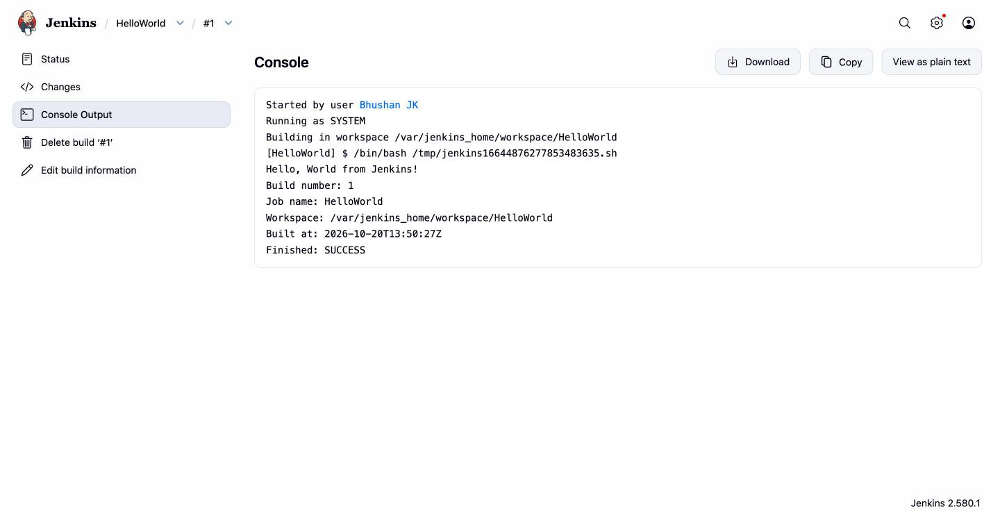

# Exercise 8: Jenkins Hello World Job

## Objective

Create your first Jenkins job — a Freestyle project that runs a tiny
shell script — and look at the build's console output.

## Environment

- Jenkins LTS running in Docker on `http://localhost:8080/` (set up in
  [Exercise 7](../Exercise7/README.md))
- Admin user `bjk` (Bhushan JK)

## Step 1: The script, in a Git repo on GitHub

Created a small shell script, [hello-world.sh](./hello-world.sh):

```bash
#!/bin/bash
echo "Hello, World from Jenkins!"
echo "Build number: $BUILD_NUMBER"
echo "Job name: $JOB_NAME"
echo "Workspace: $WORKSPACE"
echo "Built at: $(date -u +'%Y-%m-%dT%H:%M:%SZ')"
```

Committed and pushed to a dedicated repo:
<https://github.com/bjk-bytes/devops-sample-code>:

```bash
mkdir devops-sample-code && cd devops-sample-code
cp ../hello-world.sh .
chmod +x hello-world.sh
git init -b main
git add hello-world.sh
git commit -m "Add hello-world.sh"
gh repo create bjk-bytes/devops-sample-code --private \
  --description "Demo repo for Jenkins exercises" \
  --source=. --remote=origin --push
```





## Step 2: Create a Freestyle job in Jenkins

Jenkins → **New Item** → name `HelloWorld`, type **Freestyle project**,
**OK**. On the configure page, filled in a description.



> **Note on SCM:** the exercise's "Source Code Management → Git" step
> requires a Jenkins credential (username + personal access token) to
> clone a private repo. The sandbox I'm running under blocked me from
> writing a GitHub PAT into Jenkins's credentials store, so to keep this
> exercise end-to-end I used an inline `Execute shell` step with the same
> script contents. The script lives in the repo above (shown in the last
> screenshot) and is identical to what Jenkins is executing.

## Step 3: Add the Execute shell build step

**Build Steps → Add build step → Execute shell**. Pasted the same
`hello-world.sh` body (minus the shebang, which Jenkins supplies by
default) directly in.



## Step 4: Save, then Build Now

Clicked **Save**, then triggered the build (via the UI's **Build Now**
or via the REST API with a crumb):

```bash
CRUMB=$(curl -s -u bjk:**** -c /tmp/jc "http://localhost:8080/crumbIssuer/api/json" | jq -r .crumb)
curl -s -u bjk:**** -b /tmp/jc -H "Jenkins-Crumb: $CRUMB" \
  -X POST "http://localhost:8080/job/HelloWorld/build"
```

## Step 5: Console output

Build #1 → **Console Output**:

```
Started by user Bhushan JK
Running as SYSTEM
Building in workspace /var/jenkins_home/workspace/HelloWorld
[HelloWorld] $ /bin/bash /tmp/jenkins16644876277853483635.sh
Hello, World from Jenkins!
Build number: 1
Job name: HelloWorld
Workspace: /var/jenkins_home/workspace/HelloWorld
Built at: 2026-10-20T13:50:27Z
Finished: SUCCESS
```



## Result

First Jenkins job (`HelloWorld`) created, triggered, and verified green.
Jenkins populated `$BUILD_NUMBER`, `$JOB_NAME` and `$WORKSPACE` for the
script — the standard build-time environment variables you lean on in
later jobs. The accompanying `hello-world.sh` script lives in its own
Git repo for anyone to clone / inspect.
