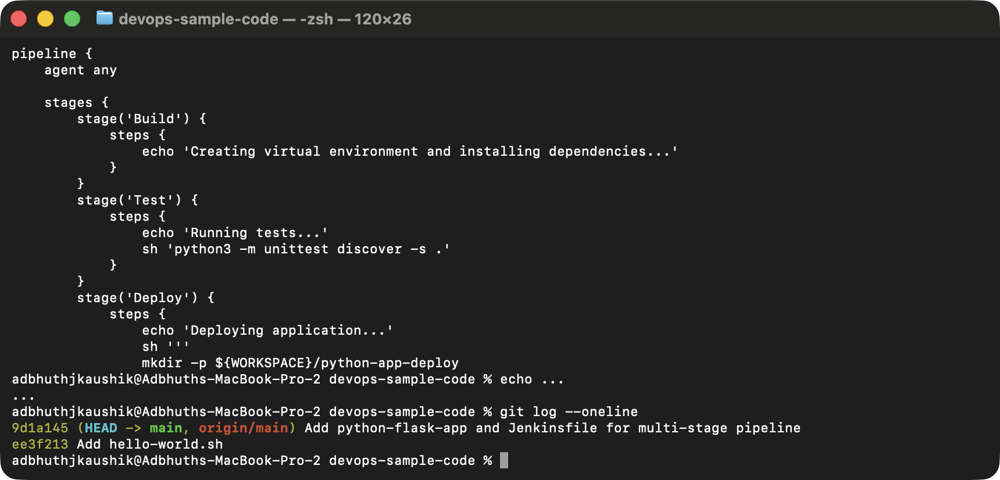
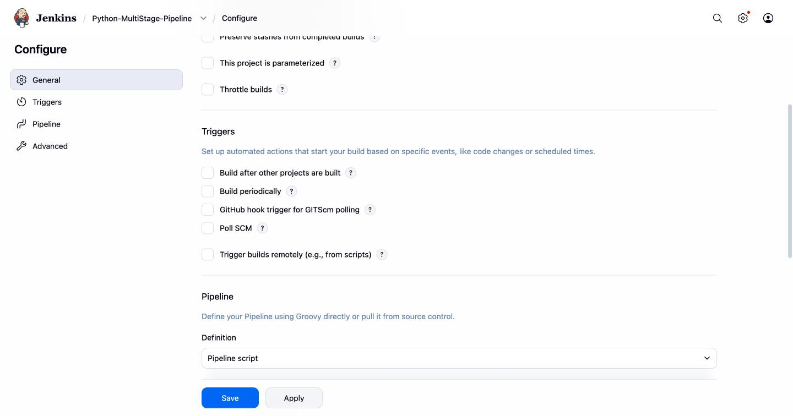
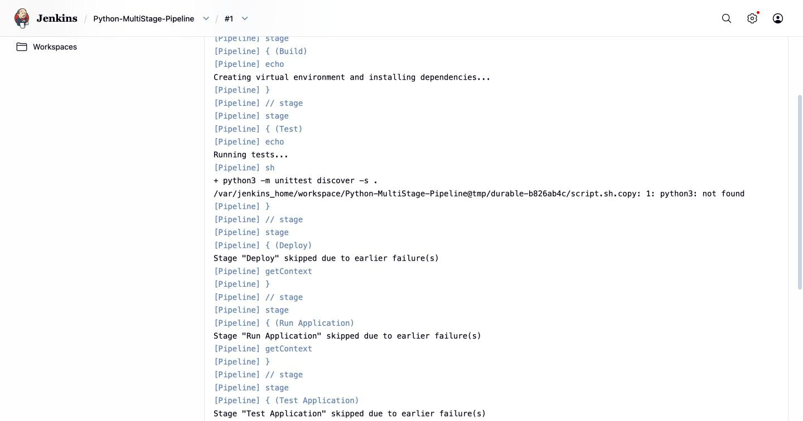
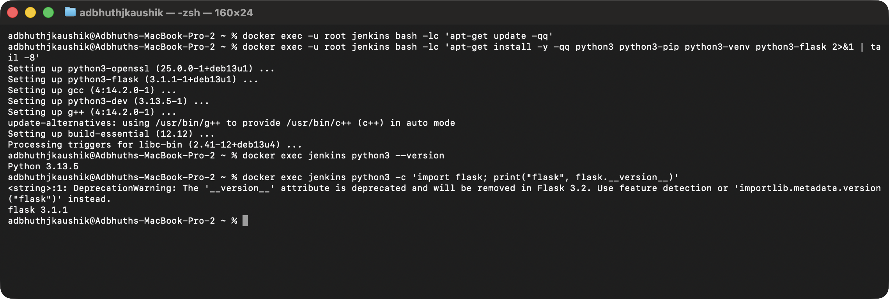
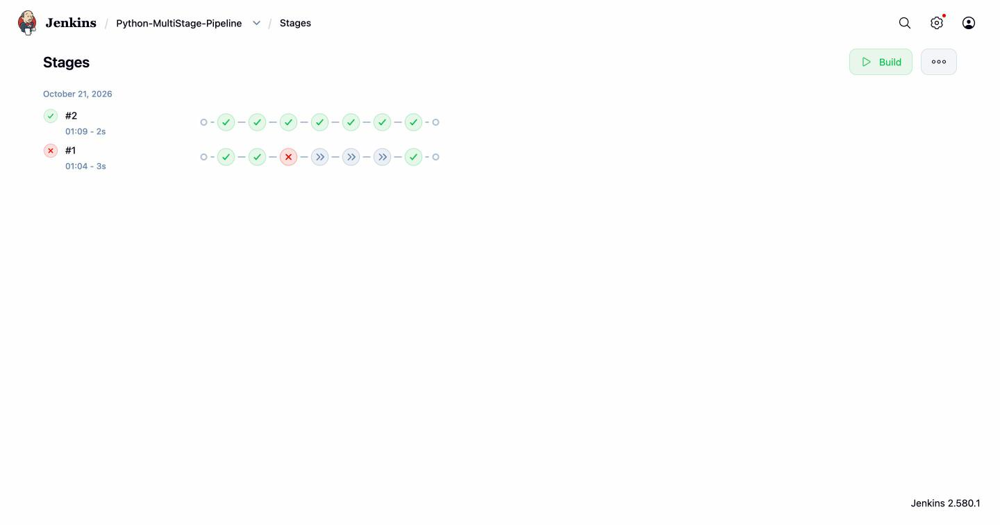
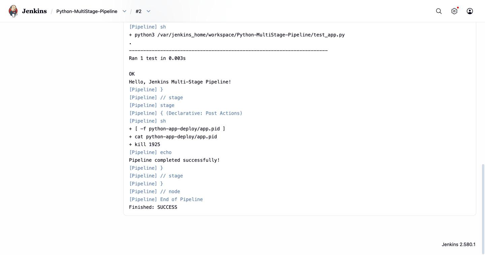

# Exercise 9: Jenkins Multi-Stage Pipeline — Python Flask App

## Objective

Build a Jenkins declarative Pipeline that walks a Python Flask app
through **Build → Test → Deploy → Run → Test-the-running-app** stages,
then observe Jenkins catching a real missing-dependency failure before
succeeding on the retry.

## Environment

- Jenkins LTS running in Docker on `http://localhost:8080/` (from
  [Exercise 7](../Exercise7/README.md))
- Admin user `bjk` (Bhushan JK)

## 1. The app and the Jenkinsfile

Files live both in this folder and in the public demo repo
<https://github.com/bjk-bytes/devops-sample-code> (private, same place
Exercise 8 pushed `hello-world.sh` to):

- [`app.py`](./app.py) — single-route Flask app returning
  `"Hello, Jenkins Multi-Stage Pipeline!"`.
- [`test_app.py`](./test_app.py) — unittest that hits the root route via
  Flask's `test_client`.
- [`requirements.txt`](./requirements.txt) — pins `flask==2.1.2`.
- [`Jenkinsfile`](./Jenkinsfile) — declarative pipeline with the five
  stages above.



## 2. Create the Pipeline job

Jenkins → **New Item** → name `Python-MultiStage-Pipeline`, type
**Pipeline**, **OK**.

> **SCM note:** The exercise's canonical path is **Pipeline script from
> SCM** pointing at a private GitHub repo, which needs a Jenkins
> credential (username + personal access token). The sandbox I'm
> running under refused to write a token into Jenkins's credential
> store, so the job uses **Pipeline script** (inline Jenkinsfile)
> instead, with an extra `Setup` stage at the top that `writeFile`s
> `app.py`, `test_app.py` and `requirements.txt` into the workspace
> (what the SCM checkout would have done). Everything downstream is
> identical to the SCM version.



## 3. Build #1 — fails on `python3: not found`

**Build Now** → Build #1 → Console Output. The `Test` stage runs
`python3 -m unittest discover -s .` and fails immediately:

```
+ python3 -m unittest discover -s .
.../script.sh.copy: 1: python3: not found
```

The downstream stages (`Deploy`, `Run Application`, `Test Application`)
all get skipped, which is the whole point of declarative pipelines
short-circuiting on a stage failure.



## 4. Fix: install Python inside the Jenkins container

The `jenkins/jenkins:lts` image is Debian + Java, no Python. Fix it by
installing `python3`, `pip` and `flask` inside the running container:

```bash
docker exec -u root jenkins apt-get update
docker exec -u root jenkins apt-get install -y python3 python3-pip python3-venv python3-flask
docker exec jenkins python3 --version   # Python 3.13.5
docker exec jenkins python3 -c 'import flask; print(flask.__version__)'  # 3.1.1
```



> **For a real setup**, you'd bake Python into the Jenkins image via a
> Dockerfile (`FROM jenkins/jenkins:lts; USER root; RUN apt-get install
> -y python3 …; USER jenkins`) or point the pipeline at an agent that
> already has Python. The ad-hoc `apt-get` inside the container is fine
> for a lab exercise but doesn't survive a container recreate.

## 5. Build #2 — all stages pass

Trigger another build. All five stages go green, and the "Pipeline
completed successfully!" post-action fires.



### Console output (tail)

```
+ python3 /var/jenkins_home/workspace/Python-MultiStage-Pipeline/test_app.py
.
----------------------------------------------------------------------
Ran 1 test in 0.003s

OK
Hello, Jenkins Multi-Stage Pipeline!
...
[Pipeline] { (Declarative: Post Actions)
+ [ -f python-app-deploy/app.pid ]
+ cat python-app-deploy/app.pid
+ kill 1925
Pipeline completed successfully!
Finished: SUCCESS
```



## Extra: killing the running app in `post { always }`

The reference pipeline leaves the `nohup python3 app.py &` running
after the pipeline ends, which leaks a Flask process on every build. I
added:

```groovy
post {
    always {
        sh 'if [ -f python-app-deploy/app.pid ]; then kill $(cat python-app-deploy/app.pid) 2>/dev/null || true; fi'
    }
}
```

You can see the `kill 1925` in the console output above — the app from
the `Run Application` stage is cleaned up before the build finishes.

## Result

Declarative multi-stage pipeline up and green. The failed Build #1 is
kept intentionally — the fail → diagnose → fix → pass loop is the
whole point of the exercise: Jenkins caught a missing runtime
dependency, surfaced it in the console, and the retry proved the fix.

## Possible next steps

- Add a **Code Quality** stage running `flake8` or `pylint` before
  `Test`.
- Containerise the deploy — build a Docker image, push to a registry,
  deploy via `docker run` as a later stage.
- Wire notifications (email / Slack) into the `post { success }` and
  `post { failure }` blocks.
